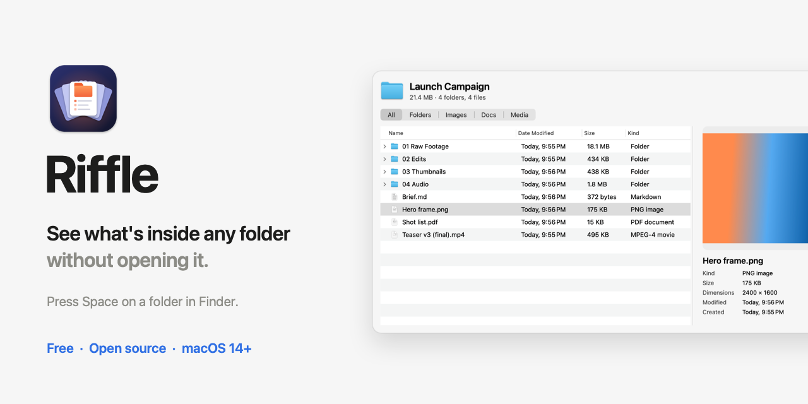
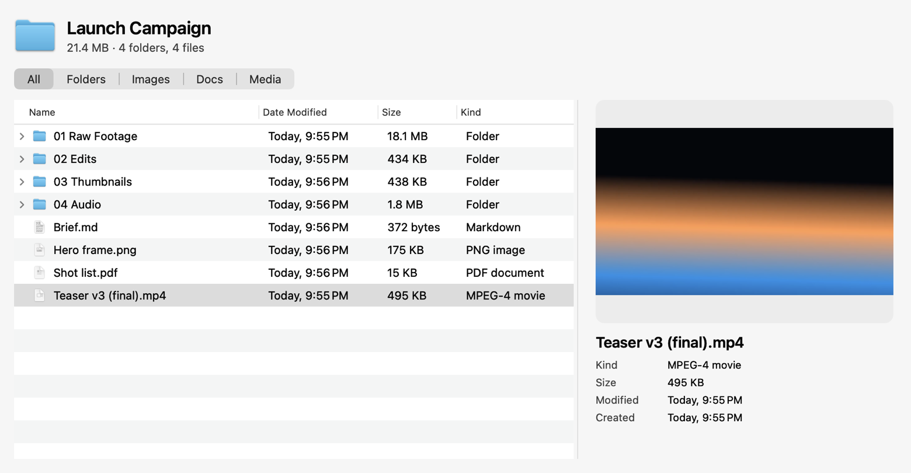
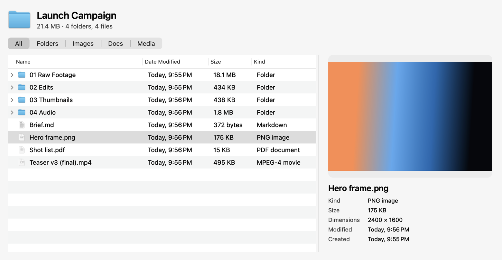
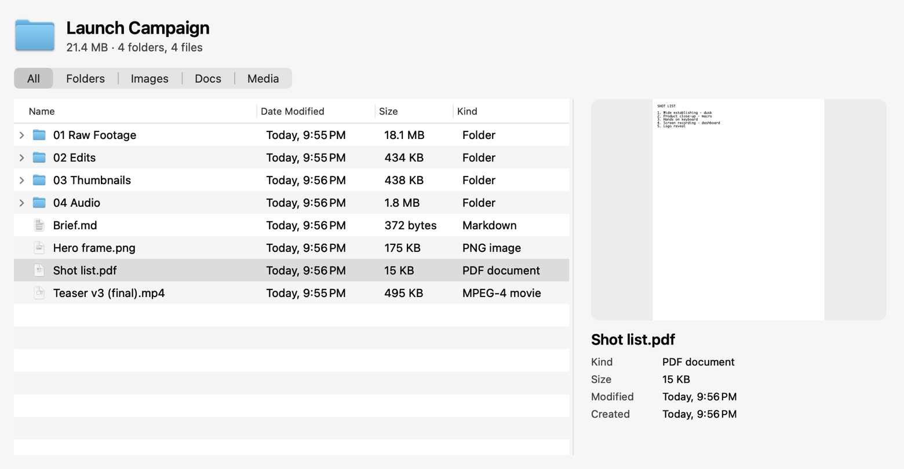
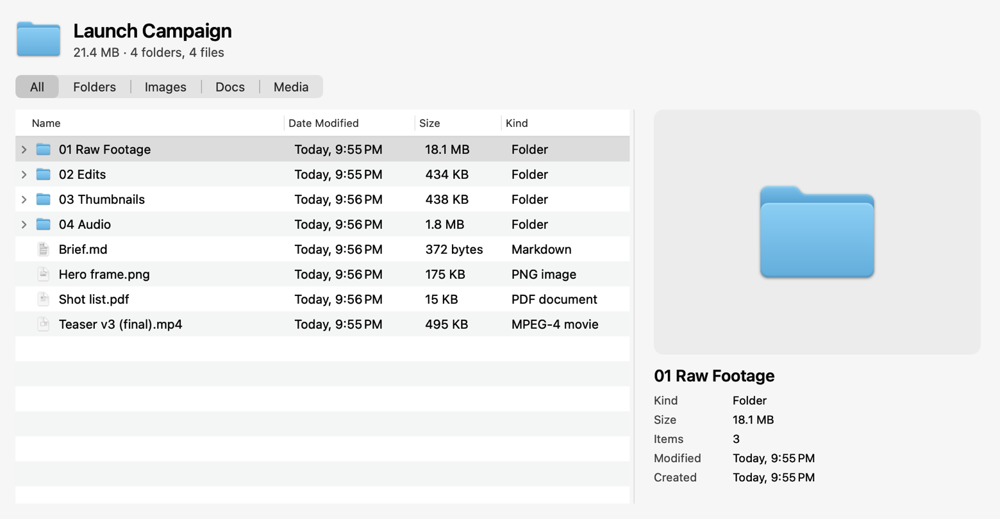
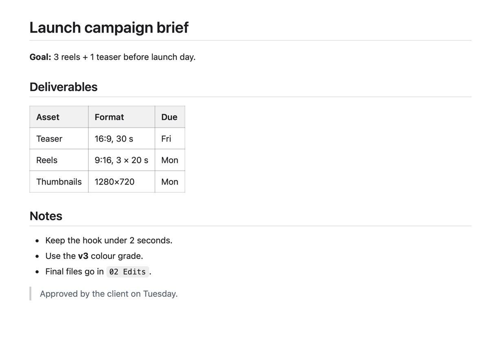

<picture>
  <source media="(prefers-color-scheme: dark)" srcset="docs/images/banner-dark.png">
  
</picture>

<p align="center">
  <a href="https://github.com/princeyadav841426/Riffle/releases/latest"></a>
  
  
  <a href="LICENSE"></a>
</p>

Press <kbd>Space</kbd> on a folder in Finder and macOS shows you a big blue folder icon. **Riffle shows you what's inside it instead**: every file and subfolder, real folder sizes, thumbnails, and details for whatever you click. No windows to open and close.

Riffle is a free, open-source Quick Look extension for macOS.

<p align="center">
  <a href="https://github.com/princeyadav841426/Riffle/releases/latest/download/Riffle.dmg"><b>⬇&nbsp; Download Riffle for Mac</b></a><br>
  <sub>Free · 2.1 MB · macOS 14 or later · Apple silicon and Intel</sub>
</p>

---

## See it in action

<picture>
  <source media="(prefers-color-scheme: dark)" srcset="docs/images/demo-dark.gif">
  
</picture>

<sub>One Space press on a folder, then click through it. (This is a demo folder made for these pictures.)</sub>

## What you get

- **The folder's contents, on Space.** Every file and subfolder with Date Modified, Size and Kind.
- **Real folder sizes.** Each subfolder is measured all the way down, in the background. The numbers match the "on disk" size in Get Info, and you can sort by Size to find what's taking up space.
- **Subfolders that open in place.** Click the arrow next to one to look inside without leaving the preview.
- **A preview pane.** Click a photo, video, PDF or document to see its thumbnail, with kind, size, pixel dimensions, item count and dates.
- **Filters.** Show only Folders, Images, Docs or Media.
- **Markdown, formatted.** Press Space on a `.md` file to read it as a page, with tables and code blocks. It works offline, and scripts inside files never run.
- **A divider you can drag.** Make the preview wider. Riffle remembers where you left it.
- **Private.** Riffle is read-only and runs inside Apple's Quick Look sandbox. No account, no analytics, nothing uploaded.

## Screenshots

<table>
  <tr>
    <td width="50%">
      <picture><source media="(prefers-color-scheme: dark)" srcset="docs/images/video-dark.png"></picture>
      <p align="center"><sub><b>Click a video</b> to see a frame from it.</sub></p>
    </td>
    <td width="50%">
      <picture><source media="(prefers-color-scheme: dark)" srcset="docs/images/photo-dark.png"></picture>
      <p align="center"><sub><b>Click a photo</b> to see it with its dimensions.</sub></p>
    </td>
  </tr>
  <tr>
    <td width="50%">
      <picture><source media="(prefers-color-scheme: dark)" srcset="docs/images/pdf-dark.png"></picture>
      <p align="center"><sub><b>Click a PDF</b> to see its first page.</sub></p>
    </td>
    <td width="50%">
      <picture><source media="(prefers-color-scheme: dark)" srcset="docs/images/folder-dark.png"></picture>
      <p align="center"><sub><b>Click a folder</b> to see its real size and item count.</sub></p>
    </td>
  </tr>
  <tr>
    <td colspan="2">
      <p align="center"><picture><source media="(prefers-color-scheme: dark)" srcset="docs/images/markdown-dark.png"></picture></p>
      <p align="center"><sub><b>Press Space on a Markdown file</b> to read it formatted.</sub></p>
    </td>
  </tr>
</table>

## Install

**1. Download** [**Riffle.dmg**](https://github.com/princeyadav841426/Riffle/releases/latest/download/Riffle.dmg). This link always gets the latest version.

**2. Open the .dmg and drag Riffle onto the Applications folder.**

**3. Open Riffle from Applications.** Riffle is free and isn't distributed through the App Store, so the first time macOS says it can't verify Riffle. That's expected. Here's how to allow it:

<details open>
<summary><b>macOS 15 Sequoia and later</b></summary>

1. In the message that appears, click **Done**.
2. Open **System Settings → Privacy & Security**.
3. Scroll down to the **Security** section. Next to *"Riffle" was blocked to protect your Mac*, click **Open Anyway**.
4. Confirm with your password or Touch ID, then click **Open Anyway** once more.

</details>

<details>
<summary><b>macOS 14 Sonoma</b></summary>

Right-click Riffle in Applications, choose **Open**, then click **Open** in the dialog.

</details>

<details>
<summary><b>Any version, using Terminal</b></summary>

```bash
xattr -dr com.apple.quarantine /Applications/Riffle.app
```

Then open Riffle normally.

</details>

**4. Wait for the green tick.** Riffle's window confirms when the Quick Look extension is on. Close it. You never need to open the app again, because Riffle runs inside Quick Look.

> [!NOTE]
> You only approve Riffle once. Updates are installed the same way: download the new .dmg and drag Riffle into Applications to replace the old copy.

## How to use it

1. **Select any folder in Finder and press <kbd>Space</kbd>.** <kbd>⌘</kbd> <kbd>Y</kbd> works too.
2. **Click any file** to see its preview and details on the right.
3. **Click the arrow next to a subfolder** to see what's inside it.
4. **Click a column header** (Name, Date Modified, Size, Kind) to sort. Click again to reverse.
5. **Use the tabs** at the top (All · Folders · Images · Docs · Media) to filter the list.
6. **Drag the divider** between the list and the preview to resize them.
7. **Press <kbd>Space</kbd> or <kbd>Esc</kbd>** to close, like any Quick Look preview.

For Markdown, select a `.md` file and press <kbd>Space</kbd>. Inside a folder preview, clicking a `.md` file renders it in the side pane.

Riffle only handles folders and Markdown files. Every other file type keeps using Apple's own Quick Look previews.

## Troubleshooting

**Space still shows the blue folder icon.**
Open Riffle from Applications. If it says Riffle is off, click **Extension Settings…** and switch Riffle on under Quick Look. On macOS 15 and later that's **System Settings → General → Login Items & Extensions → Quick Look**. On macOS 14 it's **System Settings → Privacy & Security → Extensions → Quick Look**.

**Another folder previewer is installed** (for example PeekX, Folder Preview or Folder Quick Look).
Only one app can answer Space for folders. Remove or turn off the others, and Riffle's window warns you if it spots PeekX.

**The preview still looks old after updating.**
Reset Quick Look and relaunch Finder:

```bash
qlmanage -r && qlmanage -r cache && killall Finder
```

**Something else?** [Open an issue](https://github.com/princeyadav841426/Riffle/issues) with your macOS version and a screenshot.

## FAQ

**Is it really free?**
Yes. No trial, no Pro version, no in-app purchase. It's MIT-licensed open source.

**Does Riffle read or upload my files?**
It runs in Apple's Quick Look sandbox with read-only access to what you preview. It has no account, no analytics and no tracking, and it doesn't send your files anywhere. Every line of code is in this repository.

**Why isn't it on the App Store or notarized by Apple?**
Both need a paid Apple developer account. Riffle is free, so you approve it once in Privacy & Security instead.

**Can it look inside ZIP or RAR files?**
Not yet. Folder previews and Markdown only, for now.

**How do I uninstall it?**
Drag Riffle from Applications to the Trash. Quick Look goes back to showing folder icons.

## Build from source

Only the Xcode Command Line Tools are needed (`xcode-select --install`). Full Xcode isn't required.

```bash
git clone https://github.com/princeyadav841426/Riffle.git
cd Riffle
scripts/build.sh            # builds build/Riffle.app and dist/Riffle-<version>.dmg
scripts/build.sh --install  # also installs into /Applications and refreshes Quick Look
```

The build is universal (arm64 + x86_64) and ad-hoc signed. `scripts/harness.sh <folder> <out-prefix> [width] [height] [rows]` renders the preview offscreen to PNGs, so you can check layout without going through Quick Look. See [docs/ARCHITECTURE.md](docs/ARCHITECTURE.md) for how the pieces fit together.

## Credits

Riffle started as a fork of [PeekX](https://github.com/altic-dev/PeekX) by ALTIC (MIT). Since then it's had a rebuilt preview pane and layout, recursive folder sizes, thumbnails, offline Markdown, a draggable divider and a setup app. Markdown is rendered with [marked](https://github.com/markedjs/marked) (MIT). See [NOTICE.md](NOTICE.md).

Made by [Aignix](https://aignix.online).

## License

[MIT](LICENSE) © 2026 Aignix · portions © 2025 ALTIC
