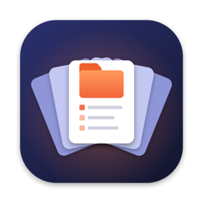
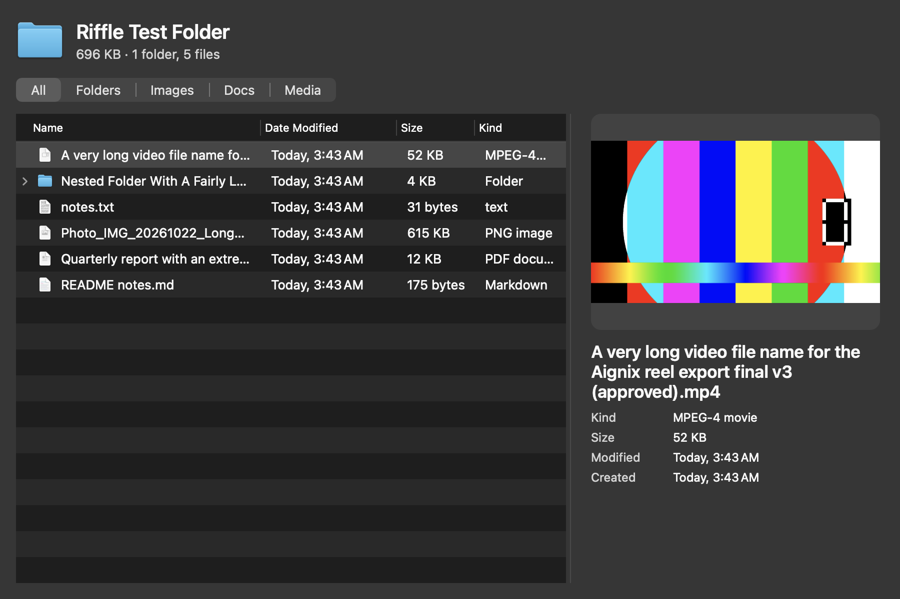

<p align="center">
  
</p>

<h1 align="center">Riffle</h1>

<p align="center"><b>See what's inside any folder without opening it.</b><br>
Select a folder in Finder, press <kbd>Space</kbd>, and riffle through everything inside.</p>

<p align="center">
  
</p>

## What it does

macOS Quick Look shows a big blue icon when you press Space on a folder. Riffle replaces that with the folder's contents:

- **Every file and subfolder**, with Date Modified, Size and Kind — sortable, and you can expand subfolders right in the preview.
- **Real folder sizes.** Folders are measured recursively in the background, so the numbers match Finder's Get Info.
- **A preview pane** for whatever you click: photos, video frames, PDFs and documents get real thumbnails; markdown renders as a formatted page.
- **Details that fit.** Kind, size, dimensions, item count, modified and created dates — long file names wrap instead of getting cut off.
- **A divider you can drag**, and Riffle remembers where you left it.
- **Filters**: All · Folders · Images · Docs · Media.
- **Markdown files** open as formatted pages when you press Space on them directly.

Riffle is read-only and runs inside Apple's Quick Look sandbox. It has no analytics and doesn't phone home. Markdown is rendered on your Mac with a bundled copy of [marked](https://github.com/markedjs/marked), and scripts inside documents never run.

## Install

1. Download **Riffle-x.y.z.dmg** from [Releases](../../releases/latest).
2. Open it and drag **Riffle** into **Applications**.
3. Open Riffle from Applications. Riffle is free and isn't sold through Apple, so the first launch shows *"Apple could not verify Riffle…"*. Click **Done**, then go to **System Settings → Privacy & Security** and click **Open Anyway**.
   Or run this in Terminal:
   ```bash
   xattr -dr com.apple.quarantine /Applications/Riffle.app
   ```
4. Riffle shows a green check when it's ready. Select any folder in Finder and press **Space**.

Requires macOS 14 Sonoma or later, on Apple silicon or Intel.

**Not working?** Open Riffle and click **Extension Settings…**, then make sure Riffle is switched on under Quick Look. If you also have PeekX installed, remove it. Two folder previewers can't both answer the same Space press.

**Uninstall:** drag Riffle from Applications to the Trash.

## Build from source

Only the Xcode Command Line Tools are needed (`xcode-select --install`). Full Xcode isn't required.

```bash
git clone https://github.com/princeyadav841426/Riffle.git
cd Riffle
scripts/build.sh            # → build/Riffle.app and dist/Riffle-<version>.dmg
scripts/build.sh --install  # also installs into /Applications and refreshes Quick Look
```

The build is universal (arm64 + x86_64) and ad-hoc signed. `scripts/harness.sh <folder> <out-prefix> [width] [height] [rows]` renders the preview offscreen to PNGs, for checking layout without going through Quick Look.

## Credits

Riffle started as a fork of [PeekX](https://github.com/altic-dev/PeekX) by ALTIC (MIT). Since then it has a rebuilt preview pane and layout, recursive folder sizes, thumbnails, offline markdown rendering, a draggable divider and a setup app.
Markdown rendering uses [marked](https://github.com/markedjs/marked) (MIT).

## License

[MIT](LICENSE) © 2026 Aignix · portions © 2025 ALTIC.
